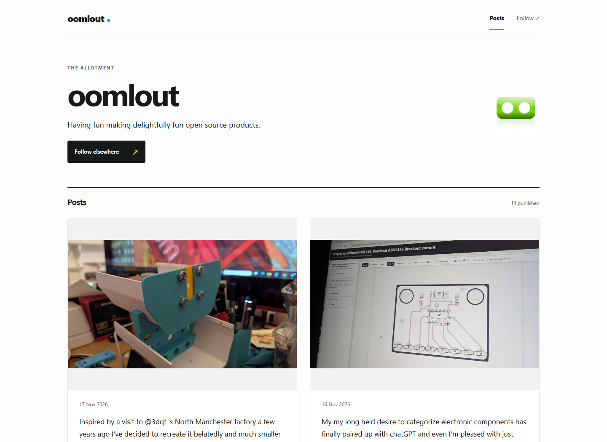
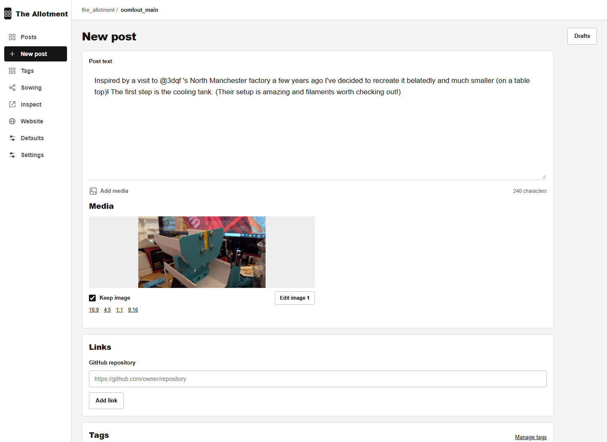
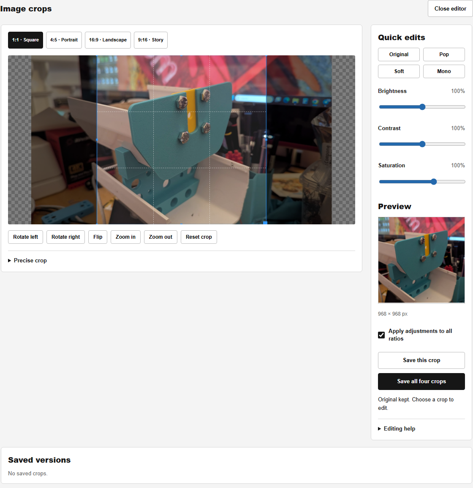
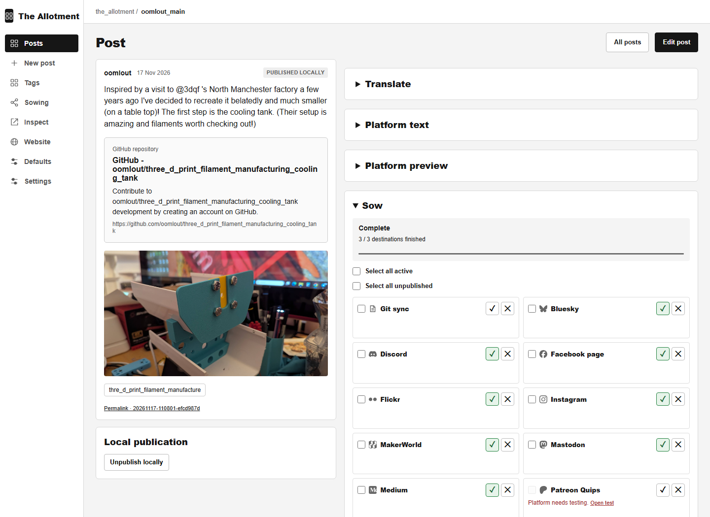
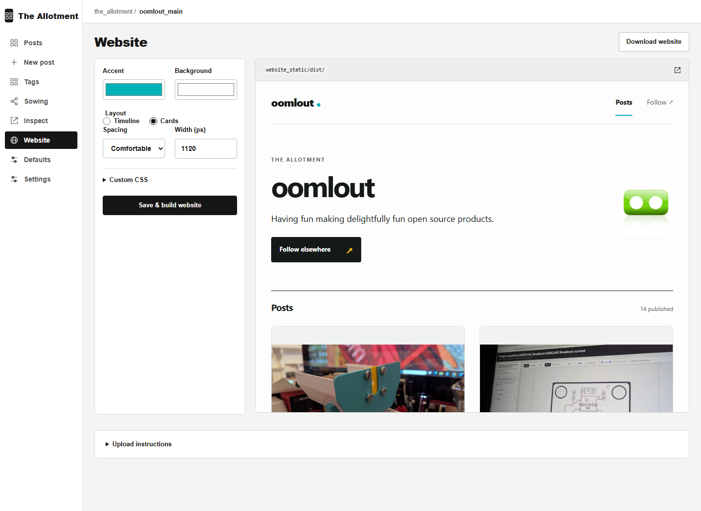
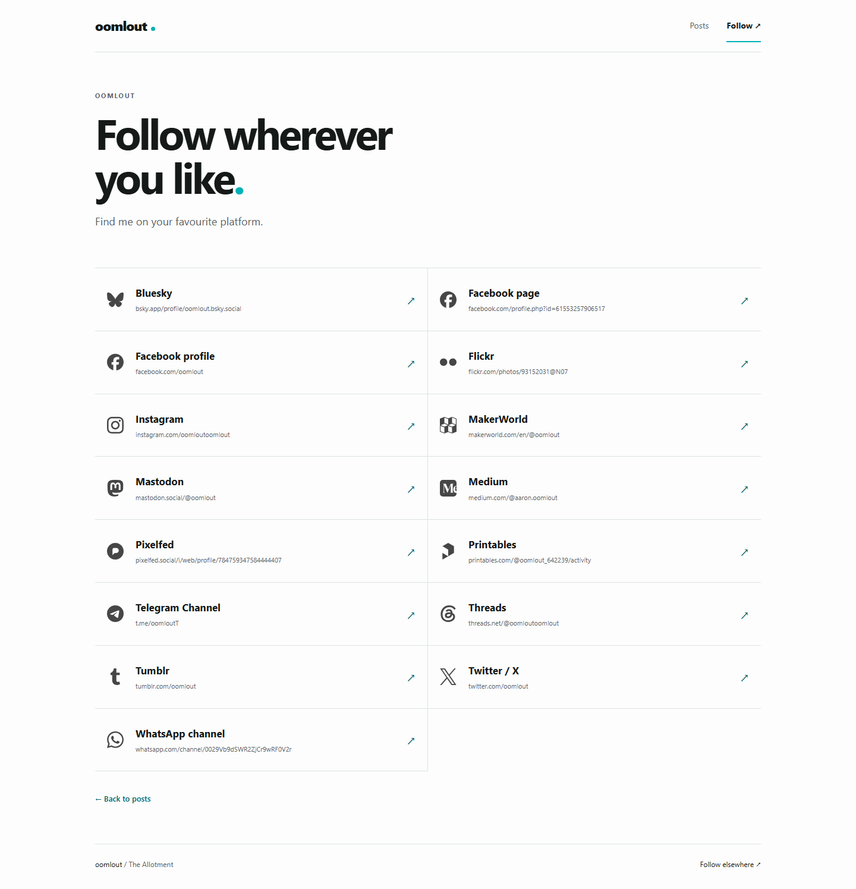

# The Allotment

The Allotment is a local post studio with a static website builder and roboclick workflows for preparing posts on other platforms. Write a post once, keep the original and its media in a folder you control, then **sow** versions of it wherever your audience prefers to follow.

The idea is simple: your work should have a home of its own. Someone can read it on your website, someone else can follow on Bluesky, and another person can keep up through a channel or community they already use. You keep the source, choose the destinations and make the final decision to publish.

> **AI-generated code — a starting point for your own AI.**
> This project was built with AI assistance. It is intended to be useful as it stands, and to give you a working codebase to point your own AI at and adapt. Expect rough edges, review changes and test them. Start your AI with [AGENTS.md](AGENTS.md) and the relevant guides below. Browser layouts change; platform recipes need maintenance.



The public site is plain HTML, CSS and media. The Studio runs on your computer. Social preparation uses your normal, signed-in Chrome window through the **oomlout roboclick** framework. **It leaves drafts ready for you: it does not click Post, Send, Share or Publish on a social platform.**

## One post, separate destinations

| Stage | What happens |
| --- | --- |
| **Create** | Save private drafts with text, images or video, links and tags. Edit crops without overwriting originals. |
| **Publish locally** | Put the finished post in your selected garden repository. This does not submit anything to another platform or push Git. |
| **Sow** | Choose destinations, prepare their drafts, review them and submit manually. The website and Allotment summary are built as part of a launch. Git sync is a separate choice. |

The original post remains independent of any one platform. Each destination can use different text and an appropriate image crop. A static site gives readers a place to browse the work without needing an account on a social platform.

## Start the Studio

The desktop automation is designed for **Windows**, with **Python 3.11+**, **Git**, **Google Chrome** and **Tesseract OCR with English language data**. Chrome and Tesseract are separate applications; `setup.bat` installs the Python dependencies. You can create posts and build the website without running social automation.

From a local checkout, run:

```powershell
.\setup.bat
.\start_studio.bat
```

Open **[localhost:8879](http://127.0.0.1:8879)**. Choose a garden card when prompted. Studio works with one garden per launch and remembers the selection. Settings stores the port, Chrome and OCR options.

Setup creates two independent data repositories:

```text
garden/the_allotment/oomlout_main/
garden/the_allotment/allotment_main/
```

`the_allotment` is the namespace; `oomlout_main` and `allotment_main` are users within it. Other namespaces can have their own users without sharing paths. The tools repository and the garden repositories are separate Git repositories.

To select another garden or bind one explicitly:

```powershell
.\start_studio.bat --choose-garden
.\start_studio.bat --garden the_allotment/oomlout_main
```

`start_studio.bat --port 8879` sets and saves a port. Configure a garden's Git remote in Settings if you want to sync it. Public profile details and public follow links are distinct from the private browser configuration used to prepare drafts.

## Create a post

Open **New post**, write the text and add images or video. Attach a GitHub repository or additional links; saving fetches their titles and descriptions for richer link cards. Add tags to describe and group your posts. Tag names use `lower_case_with_underscores`; the Tags page supports browsing, renaming, grouping and merging.

**Save draft** keeps the post private. **Save & view post** opens its unique Studio page, where local publication, translation, sowing and inspection are kept together.

<details>
<summary>Screenshot: creating a post</summary>



</details>

Uploading a still image opens an editor inside the post form. Each of the four crops—**1:1**, **4:5**, **16:9** and **9:16**—starts centred and has its own draggable framing. Rotate, flip or adjust brightness, contrast and saturation, then save one crop or all four. Original media is retained. Videos and animated images stay as original attachments.



Default framing is configurable per platform, with overrides for individual posts. The editor uses a locally pinned Cropper.js library; the [image editor guide](allotment/guides/IMAGE_EDITOR_GUIDE.md) covers its data format and maintenance.

## Adapt the text, then sow

A short update does not have to read the same everywhere. On the post page, **Translate → Generate versions** can use roboclick to open ChatGPT, supply the post, images and complete platform instructions, capture tagged JSON and load the result into **Platform text**. You can also import the JSON yourself or edit each platform's text directly. Review it and click **Save platform text**. The original stays available, and source changes require another review.

This translation step is optional and **uses the external ChatGPT service**. Local storage and static publishing do not make external translation or social platforms offline. The browser automation itself follows deterministic actions rather than asking an AI to decide every click.



To prepare social drafts:

1. Open **Sowing** and configure each destination, account identity and default crop. Sign in through normal Chrome.
2. Expand a card's **Test** section. Prepare the fixed text/image sample, review the unsent draft and explicitly mark a successful test as passed. Changed instructions invalidate that platform's test approval.
3. Publish your post locally, then open its **Sow** panel. Select individual destinations, **Select all active**, or **Select all unpublished**. Git sync is omitted from the select-all controls.
4. Click **Launch**. The visible countdowns give you time to choose the Chrome window and hand over control. Each platform gets a fresh tab; prepared drafts are left for your review.
5. Review and click the platform's final submission button yourself. Back in Studio, use **✓** to mark it posted or **✕** to reset it for another attempt. These decisions survive page reloads and app restarts; clicking a selected check again clears the confirmation.

A successful preparation is not proof of delivery. The checkmark records **your confirmation**, and a platform that needs testing remains unavailable until its test is approved.

Roboclick uses ordinary mouse and keyboard input, local screenshots, OCR, image matching and keyboard/clipboard capture. It does not need browser debugging or a browser driver for social preparation. Chrome is placed in the top-left quarter and returned to 100% zoom. Leave the mouse, keyboard and clipboard idle while it runs. Use **Stop** or **F8** to interrupt; focus and input guards stop unexpected interactions. WhatsApp allows only one active web tab, so review its existing draft before preparing another.

Recipes cover a growing range of platforms, but availability depends on their current calibration and your local test evidence. See the [platform repair guide](allotment/guides/AI_PLATFORM_GUIDE.md) and [preparation-only guide](allotment/guides/PREPARATION_ONLY_GUIDE.md).

## Build and upload your static website

The **Website** tab creates a single feed, a full page for every published post, tag pages and a **Follow** page. Choose cards or a timeline, colours, spacing and width. Add Custom CSS to restyle it without editing the page templates.



1. Open **Website** in Studio.
2. Choose your appearance and click **Save & build website**.
3. Click **Download website** to get **`the_allotment.zip`**.
4. Extract the ZIP's contents into **`/allotment/`** on your web host.
5. Visit `https://your-domain.example/allotment/`.

You can also build from the checkout with the environment created by setup:

```powershell
.\.venv\Scripts\python.exe -m allotment build the_allotment oomlout_main
```

Each build produces:

| Path | Contents |
| --- | --- |
| `website_static/dist/` | Complete, ready-to-upload site: `index.html`, `p/`, `tags/`, `follow/`, assets and post media. |
| `website_static/the_allotment.zip` | Upload archive with `index.html` at its root—no enclosing `dist` folder. |
| `allotment_static/<namespace>/<user>/` | Garden-specific copy used by the Studio preview. |

The shared `website_static` export is the **most recently built or downloaded garden**. The garden-specific previews remain separate. The ZIP can be hosted at a domain root or another subfolder because its links are relative. It also opens locally from `dist/index.html`. Visitors need no Flask server, JavaScript, external font service or social login.

Only published content enters the feed. The builder uses small image previews where possible and retains full-size media on the post pages. It does not combine gardens or run an aggregator. To update the hosted site, build and upload a fresh export. Unpublishing locally does not remove a copy already uploaded to your host or posted elsewhere.

The default oomlout theme uses the OOBB teal, dark text and small yellow accents. Styles load in this order:

```text
assets/style.css    Base layout and design tokens
assets/theme.css    Generated profile settings
assets/custom.css   Your saved overrides, loaded last
```

Save overrides in Studio's **Custom CSS** field so they survive rebuilding. For example:

```css
:root {
  --accent: #00b1b7;
  --link: #00676b;
  --yellow: #fec601;
  --feed-width: 1120px;
  --radius: 8px;
}
```

See the [static website guide](website_static/README.md) for the full styling interface, templates and upload details.

## Let people follow where they feel comfortable

The **Follow** page links to your public profiles with platform logos and full addresses. Someone who prefers a messaging channel can use that; someone who prefers a social feed can follow there. The website remains a shared home for the original posts.

The page uses public profile links and the explicit public-link preferences in Sowing configuration. It does not turn private chat targets into public invitations. A disabled public-link preference hides that address from the export.

<details>
<summary>Screenshot: the public Follow page</summary>



</details>

## What lives where

```text
the_allotment_version_5/                 Tools checkout
├── README.md                           This introduction and setup guide
├── AGENTS.md                           Instructions for your coding AI
├── setup.bat                           Create Python environment and gardens
├── start_studio.bat                     Launch the local Flask Studio
├── allotment/                          Application source
│   ├── plugins/                        Platform workflow YAML
│   ├── platform_assets/                Platform screenshot references
│   ├── roboclick/                      Pinned oomlout roboclick framework
│   ├── preparation_actions/            Draft-preparation actions
│   ├── translation_actions/            Translation actions
│   ├── workflow_extensions/            Workflow extension data/code
│   ├── templates/                      Studio and public-site HTML
│   ├── static/                         CSS, scripts, logos and fixed sample
│   ├── presets/                        Account setup presets
│   └── guides/                         Workflow and maintenance instructions
├── garden/                             Independent public data repositories*
│   └── the_allotment/
│       ├── oomlout_main/
│       │   ├── profile.yaml            Public identity, links and theme
│       │   ├── profile/                Profile images, where configured
│       │   ├── tags.yaml               Tag catalogue, when created
│       │   ├── posts/YYYY/MM/DD/<id>/
│       │   │   ├── post.yaml           Published text, links and metadata
│       │   │   ├── media/              Attachments and saved crop versions
│       │   │   └── harvest/            Captured findings, when available
│       │   └── .allotment/queue/       Public launch snapshots and receipts
│       └── allotment_main/             Second garden, same data layout
├── .local/                             Private local state; ignored by Git
│   ├── drafts/<namespace>/<user>/      Unpublished posts and media
│   ├── accounts/                       Destination settings and approvals
│   ├── translations/                   Captured JSON and platform text
│   ├── job-runs/                       Local launch progress and evidence
│   ├── preparation-tests/              Draft-test payloads and evidence
│   ├── platform-tests/                 Bluesky test evidence
│   ├── roboclick-walkthrough/          Disposable desktop fixture evidence
│   ├── studio.yaml                    Garden selection and port
│   └── worker.yaml                    Desktop worker settings
├── website_static/
│   ├── README.md                       Static-site maintenance guide
│   ├── dist/                           Generated upload directory*
│   └── the_allotment.zip               Generated upload archive*
├── allotment_static/                   Per-garden generated previews*
├── docs/images/                        README screenshots
├── tools/                              Maintenance and migration utilities
└── tests/                              Automated checks and desktop fixtures
```

`*` Generated output and the entire `garden/` directory are ignored by the **tools repository**. Each garden has its own Git history. Keep `.local/` private and back it up separately if you want to retain drafts, translations, approvals and launch history. Never add it to a public garden. Some folders are created only when the corresponding feature is used. `.venv/`, build directories and caches are disposable local tooling output.

## Inspection and stored findings

The **Inspect** navigation tab is a list of profile links for quick manual checking. The separate **Inspect** panel on a post is for roboclick capture: first identify a manually submitted post, then collect the visible reactions and replies. That workflow starts with Bluesky and has its own testing and approval gates; other platforms need their own verified recipes. Findings go back beside the post, with screenshot and clipboard evidence kept in `.local/`.

See the [harvest workflow and handoff guide](allotment/guides/HARVEST_HANDOFF.md). User-confirmed posting, captured post IDs and harvested engagement are separate records.

## Point your AI at the project

Give your coding AI this repository, [AGENTS.md](AGENTS.md), and a concrete change to make. For example:

> Read AGENTS.md and the static website guide. Change the public site's layout while keeping relative links, the ZIP export and the original post folders intact. Check desktop and mobile layouts. Do not alter social-platform recipes or approvals.

Use the guide for the area being changed:

| Work | Starting point |
| --- | --- |
| Static website and theme | [Website guide](website_static/README.md) · `allotment/website.py` · `allotment/templates/public*.html` · `allotment/static/public.css` |
| Creation, crops, tags and links | [Image editor guide](allotment/guides/IMAGE_EDITOR_GUIDE.md) |
| Platform-specific translation | [Translation guide](allotment/guides/TRANSLATION_GUIDE.md) · [Complete prompt instructions](allotment/guides/PLATFORM_TRANSLATION_PROMPT.md) |
| Browser platform repair | [AI platform guide](allotment/guides/AI_PLATFORM_GUIDE.md) · [Preparation guide](allotment/guides/PREPARATION_ONLY_GUIDE.md) |
| Post IDs, replies and counts | [Harvest handoff](allotment/guides/HARVEST_HANDOFF.md) |

Prefer a platform's YAML and reference assets when repairing its UI workflow. A test pass belongs to the user and the checked recipe; an AI must not bypass that gate or click a final submission button. Ordinary sowing runs should remain deterministic, with no mid-run AI handoff.

Install test tools into the same environment, then run the checks appropriate to the change:

```powershell
.\.venv\Scripts\python.exe -m pip install -e ".[test]"
.\.venv\Scripts\python.exe -m playwright install chromium
.\.venv\Scripts\python.exe -m pytest -q
```

Playwright is used for isolated local web-interface tests, not social-platform preparation. Native desktop fixtures use normal Chrome; arrange an idle desktop before running them. `tests/desktop_practice.py`, `tests/desktop_preparation_practice.py --prepare` and `tests/desktop_visual_practice.py` check the real input path against disposable pages. Their Post/Send/Enter traps must record **zero attempts**. Fixture success is not proof that a live platform works.

<details>
<summary>Legacy command-line workers</summary>

Earlier queue, bundle and receipt tools remain for compatibility, including `run_worker.bat`. Queue pages and deferred batch controls are not part of the current Studio flow. Launch from the post page for the immediate workflow described above. Old delivery receipts do not approve a new preparation recipe.

</details>

Screenshots show the November 2026 interface and public oomlout content. The creation and crop examples were captured in a disposable local garden; capturing this documentation did not submit any social posts.
